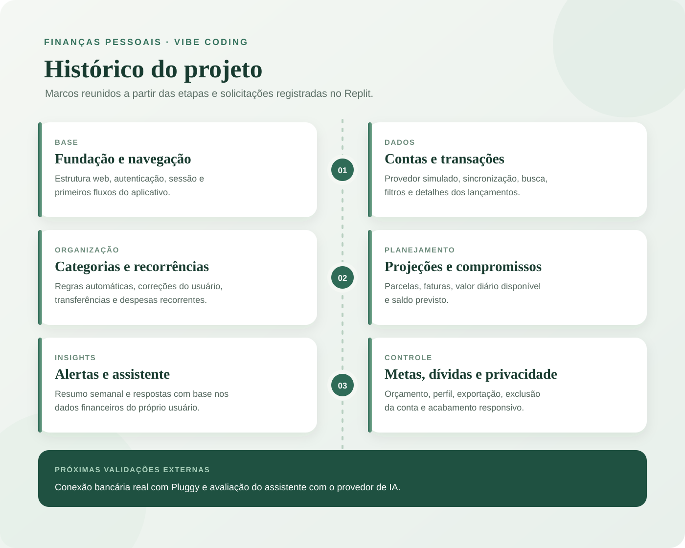
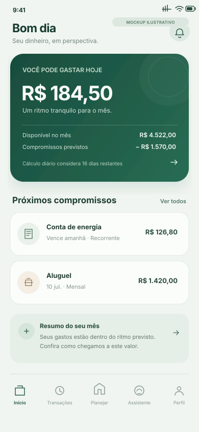
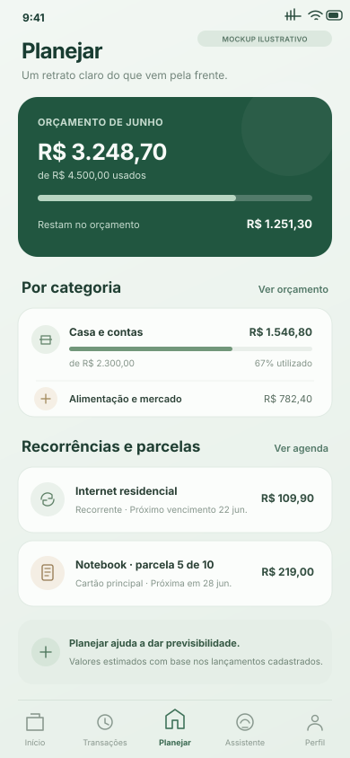
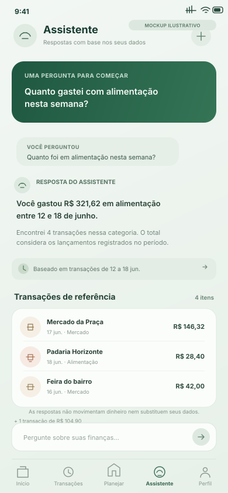

# Finanças Pessoais com IA — projeto de Vibe Coding

Este projeto explora como transformar uma necessidade cotidiana em um produto digital usando conversas com IA no Replit. A proposta é um app de finanças pessoais que ajuda a entender gastos e tomar decisões com mais clareza.

## ✨ O que é Vibe Coding

**Vibe Coding** é uma forma leve e criativa de desenvolver com IA, baseada em **conversas naturais e bem estruturadas**. Você não precisa escrever código linha por linha. Em vez disso, aprende a **guiar a IA** descrevendo suas ideias de forma clara, com **intenção e contexto**. Em outras palavras:

> Você mostra a vibe da sua ideia e a IA transforma em solução (ou em um caminho para ela).

## 🎯 Desafio

Problema: Muitas pessoas não conseguem manter um controle financeiro porque os aplicativos exigem muita entrada de dados manual, e a criação de orçamentos é vista como algo tedioso. 

Precisamos de uma solução que permita **controlar as finanças por meio de uma conversa simples**, com **agentes de IA** capazes de criar **planos de economia personalizados e automatizados**. Você deve utilizar as ideias de **Vibe Coding** e **MVP (Produto Mínimo Viável)** para desenvolver o **conceito de um aplicativo** que resolva o problema citado.

> [!IMPORTANT]
> O foco deste projeto é usar a IA como parceira de planejamento e desenvolvimento, trabalhando com requisitos claros, entregas incrementais e validação do resultado.

## 🪄 Etapas do Desafio

### 1. Saber o que Pedir é a Chave! Otimize seus Prompts!

Antes de pedir para a IA "criar um app", é importante definir com clareza o que você quer construir e por quê. Para isso, você vai criar um **PRD (Product Requirements Document)** simplificado, uma especificação que serve como _briefing_ para a IA entender sua ideia.

Um bom PRD descreve o problema, quem será beneficiado, as funcionalidades e os limites do produto. O prompt consolidado deste projeto está na seção [Prompt final (PRD)](#prompt-final-prd) e no arquivo [`docs/PROMPT.md`](docs/PROMPT.md).

> [!TIP]
> Pense no PRD/Prompt como “o briefing que a IA precisa para entender sua vibe”. Portanto, quanto mais claro e intencional for o texto, mais próximas do ideal serão as respostas da IA.

### 2. Explorando o Replit na Prática

Com o PRD pronto, use o Replit Agent para desenvolver o produto em etapas pequenas. Peça uma entrega por vez, informe como ela deve ser validada e compare o resultado com os requisitos antes de seguir:
- Faça solicitações específicas, com critérios de aceite claros;
- Valide cada etapa com testes e conferência visual;
- Quando algo divergir da especificação, aponte o requisito exato e peça uma correção delimitada.

Durante o processo, a IA pode ajudar a decompor requisitos, propor interfaces, implementar regras e criar testes. As decisões financeiras continuam apoiadas em regras explícitas e dados do próprio usuário.

> [!TIP]
> O mais importante é transformar intenções em instruções claras e conferir o que a IA produziu, em vez de aceitar respostas sem validação.

### 3. Entregando o Desafio na DIO

Finalize seu projeto criando um **repositório no GitHub** (pode ser um **fork** deste).  
No README do seu repositório, inclua:

- Seu **prompt final** (PRD);  
- Prints ou pequenos vídeos das interações com a IA;  
- Um resumo do que o seu **App de Finanças Pessoais** faz;  
- Uma breve **reflexão sobre o processo**:
  - O que funcionou bem?  
  - O que não funcionou como o esperado?  
  - O que aprendeu sobre conversar com IAs?

> [!TIP]
> Publique seu repositório e compartilhe o link na plataforma da DIO! Sua entrega é a prova de que você domina o raciocínio de Vibe Coding, mesmo sem escrever uma única linha de código.

## Conceito do app

Finanças Pessoais é a proposta de um app web responsivo, pensado primeiro para celular, que reúne contas, cartões e transações em uma visão financeira única. A categorização automática reduz lançamentos manuais; a tela inicial ajuda a entender quanto ainda é possível gastar; e as áreas de planejamento organizam recorrências, parcelas, orçamento, metas e dívidas. Um assistente em linguagem natural responde perguntas usando os dados financeiros do próprio usuário. O produto não movimenta dinheiro, não oferece crédito e não recomenda investimentos.

## Prompt final (PRD)

O PRD completo está em [`docs/PROMPT.md`](docs/PROMPT.md). Ele consolida o problema, o público-alvo, a experiência desejada, as funcionalidades e os limites do app.

## Histórico visual

*Resumo visual das etapas registradas durante o desenvolvimento; não é uma captura da conversa.*

## Telas do app (mockups ilustrativos)

Estas ilustrações representam as principais áreas do produto com conteúdo fictício. São mockups baseados no PRD, não capturas reais do aplicativo.

Início

Transações

Planejar

Assistente

## Interações com o Replit

Não havia capturas de tela ou gravações reais das conversas com o Replit nos arquivos disponíveis neste checkout. As telas acima são mockups identificados como ilustrações; as rotas públicas do build atual falharam na prévia estática, então não foram apresentadas como capturas reais.

## Reflexão

Aprendi que a qualidade do resultado depende de explicar o problema, o público e os limites antes de pedir a implementação. Dividir o trabalho em etapas e validar cada uma com critérios claros e testes ajuda a encontrar erros sem acumular mudanças. Também percebi que integrações externas precisam ser verificadas de ponta a ponta: uma funcionalidade pode estar implementada, mas ainda depender de permissões e autenticação corretas para ser publicada.

## 💬 Conclusão

Vibe Coding é sobre clareza, curiosidade e criatividade, não sobre perfeição técnica. O verdadeiro objetivo aqui é aprender a pensar junto com a IA, transformando ideias em conceitos reais e enxergando a tecnologia como uma extensão do seu raciocínio criativo. Cada interação é um experimento, quanto mais clara for sua intenção, mais surpreendente será o resultado.
